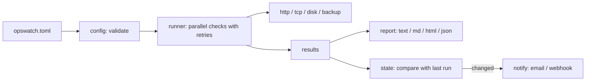

# opswatch

[](https://github.com/Ritzplr/opswatch/actions/workflows/ci.yml)


Hands-off health checks for small teams. One TOML file, one command, no agents and no dependencies.

I built it from lessons running a small cloud platform where nobody watches dashboards all day. The failures that hurt were quiet ones: a backup job that kept running but wrote empty files, a TLS certificate that expired on a weekend, a disk that filled slowly. `opswatch` checks for exactly those and only tells you when something **changes**.

```text
$ opswatch run -c opswatch.toml
opswatch report, 2026-10-19 09:34:44 UTC

[OK  ] Website                HTTP 200 in 29 ms
[FAIL] Admin page             expected HTTP 200, got 404
[OK  ] Database port          127.0.0.1:5432 reachable in 26 ms
[OK  ] Nightly database dump  newest backup db-nightly.sql.gz (52,000 bytes, 0.0 h old)

FAIL: 3 ok, 0 warning, 1 failing of 4
```

## What it checks

| Type | Fails when | Warns when |
|---|---|---|
| `http` | wrong status, text missing from the body, request error | slower than `latency_warn_ms`, TLS certificate expires within `cert_warn_days` |
| `tcp` | the port does not accept a connection (databases, SFTP, brokers) | |
| `disk` | usage is at or above `max_used_percent` | usage is at or above `warn_used_percent` |
| `backup` | newest matching file is older than `max_age_hours`, smaller than `min_size_bytes`, or missing | newest file is older than `warn_age_hours` |

The backup check looks at the newest file matching a pattern, so it works for database dumps, snapshots exported to a folder, or cloud buckets mounted with gcsfuse or s3fs.

## Install

```bash
pip install git+https://github.com/Ritzplr/opswatch.git
opswatch init > opswatch.toml      # print an example config
opswatch validate -c opswatch.toml # catch typos before they page you
opswatch run -c opswatch.toml
```

Needs Python 3.11 or newer. There are no third-party packages.

## Alerts without the noise

```bash
opswatch run -c opswatch.toml --notify --state-file /var/lib/opswatch/state.json
```

With `--state-file`, `opswatch` remembers the last result and sends an alert only when the set of problems changes: a new failure, a warning that became a failure, or a recovery ("all checks recovered"). A check that stays down does not email you every five minutes.

Channels are configured in the same TOML file:

```toml
[notify.email]
host = "smtp.example.com"
port = 587
username = "alerts@example.com"
password_env = "OPSWATCH_SMTP_PASSWORD"   # secrets live in the environment, not the file
from = "alerts@example.com"
to = ["oncall@example.com"]

[notify.webhook]                            # Slack, Mattermost and Google Chat accept this
url = "https://hooks.slack.com/services/XXX/YYY/ZZZ"
```

A failing channel is reported on stderr and never stops the run or hides the other channels.

## Reports

```bash
opswatch run -c opswatch.toml -f md   -o report.md     # paste into a ticket
opswatch run -c opswatch.toml -f html -o report.html   # self-contained, light and dark
opswatch run -c opswatch.toml -f json                  # for dashboards and scripts
```

Exit codes make it easy to use from cron, CI or a deploy script: `0` ok, `1` warning, `2` failing, `3` bad config.

## Schedule it

```cron
*/5 * * * *  opswatch run -c /etc/opswatch.toml --notify --state-file /var/lib/opswatch/state.json
```

On Windows, create a Task Scheduler task that runs the same command, or use Docker:

```bash
docker build -t opswatch .
docker run --rm -v "$PWD:/config:ro" opswatch
```

## How it works



Design choices worth knowing:

- **Retries only for failures.** A failing check is retried with a growing delay, which absorbs blips. A warning is final, so a slow response is never retried into a pass.
- **Fail loudly on config mistakes.** Unknown options, missing fields, duplicate names and bad settings are errors, so a typo cannot silently disable a check.
- **A broken check never stops the run.** Any exception becomes a FAIL for that check only.
- **Parallel but ordered.** Checks run in a thread pool and results keep config order.
- **No dependencies on purpose.** Everything is the standard library (`urllib`, `socket`, `ssl`, `smtplib`, `tomllib`), so it installs anywhere Python runs.

## Add a check

A check is a function that returns a status and a message, registered by name:

```python
# src/opswatch/checks/mycheck.py
from ..models import Status
from . import register

@register("mycheck")
def check_mine(options: dict, timeout: float) -> tuple[Status, str]:
    return Status.OK, "all good"
```

Import it in `checks/__init__.py` and add its required and optional options to `SCHEMA` in `config.py`.

## Develop

```bash
python -m pip install -e .
python -m unittest discover -s tests -v
```

The 44 tests cover each check against real local servers and temporary files, the retry and back-off logic, config validation, report rendering and escaping, change-only alerting, and the CLI exit codes. CI runs them on Linux and Windows for Python 3.11 to 3.13.

## Roadmap

- Cloud-native backup checks that read S3 and GCS object timestamps directly
- A `--watch` mode for a long-running process
- Prometheus text output

## License

MIT
